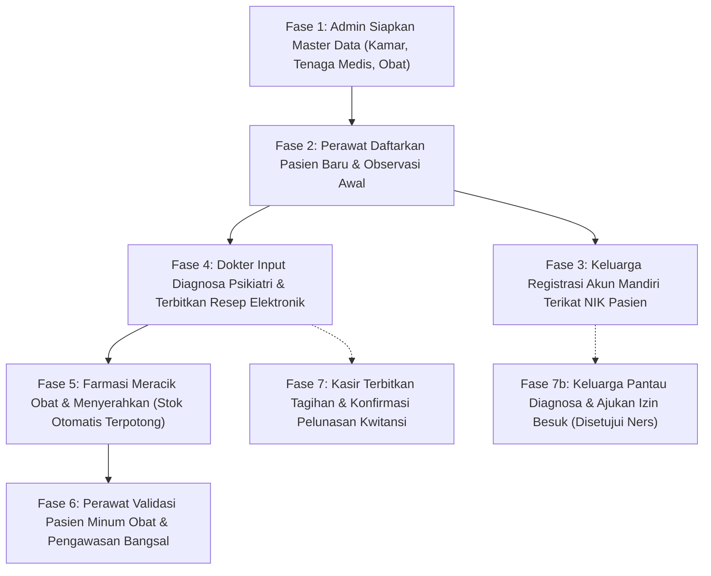

# Sistem Informasi RS Khusus ODGJ (Java Servlet & JSP)

Sistem Informasi Manajemen Pelayanan Pasien Rumah Sakit Jiwa berbasis Java Web Native (Pure Servlet & JSP) yang dirancang untuk mengintegrasikan seluruh alur operasional klinis dan non-klinis secara *real-time*. Sistem ini mencakup tata kelola data master, pendaftaran dan pengawasan pasien rawat inap/isolasi, rekam medis psikiatri, peresepan elektronik, peracikan obat & pemotongan stok otomatis di farmasi, penerbitan serta pelunasan tagihan kasir, hingga portal pantau kondisi dan izin besuk bagi keluarga pasien.

---

## 🛠️ Tech Stack & Arsitektur
- **Platform:** Java SE & Java EE Web Application
- **Komponen Backend:** Pure `HttpServlet`, Native JDBC (`Connection`, `PreparedStatement`, `ResultSet`), Session Management
- **Antarmuka (Frontend):** Java Server Pages (JSP), Bootstrap 5, Font Awesome 6, Custom CSS
- **Database Engine:** MySQL / MariaDB (XAMPP Environment)
- **Web Server / Servlet Container:** Apache Tomcat (versi 9.x / 10.x kompatibel)
- **Konektor:** MySQL Connector/J

---

## ⚙️ Cara Instalasi & Menjalankan Proyek (Local Testing)

### 1. Persiapan Database MySQL (via XAMPP)
1. Buka **XAMPP Control Panel**, lalu aktifkan modul **Apache** dan **MySQL**.
2. Buka browser atau database client (misal: phpMyAdmin di `http://localhost/phpmyadmin`).
3. Buat database baru bernama `db_rsodgj`:
   ```sql
   CREATE DATABASE db_rsodgj;
   ```
4. Impor berkas SQL yang sudah disediakan pada folder proyek:
   - Lokasi file: `database/db_rsodgj.sql`
   - Berkas ini sudah memuat skema seluruh tabel berelasi (dengan foreign keys & constraints) beserta data awal (*seeding master*).

### 2. Konfigurasi Koneksi Database
Jika konfigurasi MySQL lokal Anda berbeda (misal menggunakan password atau port custom), sesuaikan kredensial di:
```text
src/main/java/com/rsodgj/config/Koneksi.java
```
Default konfigurasi proyek:
- **URL:** `jdbc:mysql://localhost:3306/db_rsodgj`
- **User:** `root`
- **Password:** *(kosong)*

### 3. Kompilasi & Deployment ke Apache Tomcat
1. Pastikan seluruh berkas Java terkompilasi ke dalam folder `WEB-INF/classes`.
2. Salin isi folder `src/main/webapp` ke direktori deployment Apache Tomcat:
   ```text
   <TOMCAT_HOME>/webapps/RS-Jiwa-Web/
   ```
3. Jalankan server Apache Tomcat melalui `startup.bat` (Windows) atau `catalina.sh run` (Linux/Mac).
4. Akses aplikasi melalui browser pada URL:
   ```text
   http://localhost:8080/RS-Jiwa-Web/
   ```

---

## 🔑 Daftar Akun Pengguna & Hak Akses (Multi-Role)

Sistem login telah dilengkapi fitur **auto-routing role**; pengguna cukup memasukkan *username* dan *password* tanpa perlu memilih peran secara manual:

| Role / Peran | Username | Password | Deskripsi Tugas & Wewenang |
| :--- | :--- | :--- | :--- |
| **Administrator** | `admin` | `123` | Pengelolaan data master dokter, perawat, kamar rawat/isolasi, katalog obat, master user, jadwal praktik, master rekam medis, dan tagihan. |
| **Dokter Spesialis Jiwa (Sp.KJ)** | `dr_budi` | `123` | Pemeriksaan status mental, input hasil diagnosa & rekam medis klinis, penerbitan resep obat elektronik, jadwal terapi aktivitas kelompok (TAK), dan pantau riwayat konsultasi. |
| **Perawat / Ners** | `ners_eka` | `123` | Pendaftaran pasien rawat, observasi tanda-tanda vital (TTV) & agitasi, mutasi/pindah kamar rawat, verifikasi pemberian obat ke pasien, pelaporan insiden darurat, dan persetujuan izin besuk. |
| **Farmasi / Apotek** | `farmasi1` | `123` | Monitoring antrean resep masuk dari dokter, proses peracikan obat, penyerahan obat ke ners (stok fisik obat otomatis terpotong), dan penambahan stok inventaris. |
| **Kasir / Pembayaran** | `kasir1` | `123` | Rekapitulasi biaya perawatan, penerbitan billing/invoice kamar dan tindakan medis, konfirmasi pelunasan tagihan, serta pencetakan bukti kwitansi. |
| **Keluarga Pasien** | `kel_santoso` *(atau buat via registrasi NIK)* | `123` | Pemantauan perkembangan kondisi medis pasien terikat (secara transparan tanpa melanggar privasi medis), dan pendaftaran izin kunjungan/besuk. |

---

## 🧪 Skenario Pengujian Menyeluruh (7-Fase End-to-End Testing)

Untuk menguji seluruh alur dan interaksi dinamis antar-role dari hulu ke hilir, ikuti skenario pengujian 7 fase berikut:

### Skenario Alur Pengujian:


### 1. Fase 1: Persiapan Master Data (Role: `admin`)
- Login sebagai `admin` (password: `123`).
- Buka menu **Kelola Kamar**, **Kelola Dokter**, **Kelola Perawat**, dan **Kelola Obat**. Pastikan master kamar (misal: *Ruang Lavender 01*) dan ketersediaan stok obat aktif.

### 2. Fase 2: Admisi Pasien Baru (Role: `ners_eka`)
- Login sebagai `ners_eka` (password: `123`).
- Buka menu **Pendaftaran Pasien**, daftarkan pasien baru (misal: Nama: *Budi Santoso*, NIK: `3201888877770001`, Kamar: *Ruang Lavender 01*, Status: *Rawat Inap*).
- Masuk ke menu **Pantau Kondisi**, lakukan input TTV dan observasi tingkat agitasi awal pasien.

### 3. Fase 3: Pendaftaran Akun Keluarga (Portal Registrasi)
- Buka halaman login utama, klik menu **Daftar Akun Keluarga**.
- Buat akun baru (misal username: `kel_budi`, password: `123`) dengan memasukkan **NIK Pasien** yang didaftarkan pada Fase 2 (`3201888877770001`).
- Sistem secara otomatis menghubungkan akun keluarga ini hanya ke data pasien tersebut.

### 4. Fase 4: Pemeriksaan Medis & Peresepan Elektronik (Role: `dr_budi`)
- Login sebagai `dr_budi` (password: `123`).
- Buka menu **Input Diagnosa**, pilih pasien *Budi Santoso*, input keluhan dan diagnosa ICD-10 (misal: *F20.0 Skizofrenia Paranoid*).
- Buka menu **Resep Obat**, pilih pasien *Budi Santoso*, pilih obat dari katalog stok (misal: *Haloperidol 5mg*, jumlah 10 tablet) $\rightarrow$ klik **Terbitkan Resep**.

### 5. Fase 5: Distribusi & Pemotongan Stok Farmasi (Role: `farmasi1`)
- Login sebagai `farmasi1` (password: `123`).
- Buka menu **Antrean Resep**, resep elektronik pasien langsung tampil dengan status *Menunggu Racik*.
- Klik tombol **Racik Obat** (status menjadi *Sedang Diracik*), lalu klik **Siap & Serahkan** ke perawat.
- Periksa menu **Kelola Stok Obat**; sistem secara otomatis memotong stok fisik obat di database.

### 6. Fase 6: Tindakan Perawat di Bangsal (Role: `ners_eka`)
- Login sebagai `ners_eka` (password: `123`).
- Buka menu **Pemberian Obat**, temukan daftar obat pasien yang telah diserahkan dari farmasi.
- Klik tombol **Berikan** setelah pasien meminum obat $\rightarrow$ status otomatis berubah menjadi *Sudah Diminum* dan terkunci.
- Perawat juga dapat melakukan mutasi ruangan pada menu **Pindah Kamar** atau mencatat kejadian darurat di **Insiden Darurat**.

### 7. Fase 7: Pelunasan Kasir & Portal Keluarga Pasien
- **Role Kasir (`kasir1` / `123`):**
  - Buka menu **Tagihan Perawatan**, klik **Terbitkan Tagihan Baru** untuk pasien *Budi Santoso*.
  - Setelah pembayaran diterima, kasir menekan tombol **Bayar** $\rightarrow$ status berubah menjadi *Lunas* dan siap cetak bukti transaksi.
- **Role Keluarga (`kel_budi` / `123`):**
  - Login dan buka menu **Info Perkembangan**; diagnosa dan terapi yang diberikan dokter di Fase 4 dapat dipantau secara langsung.
  - Masuk ke menu **Jadwal Besuk**, ajukan jadwal kunjungan.
  - Perawat membuka menu **Verifikasi Besuk** dan menyetujui izin $\rightarrow$ status di akun keluarga berubah seketika menjadi *Disetujui Ners*.

---

## 📂 Struktur Direktori Proyek
```text
Mental Wellness Hospital project/
├── database/
│   └── db_rsodgj.sql              # Skema database & data seeding lengkap
├── src/
│   └── main/
│       ├── java/com/rsodgj/
│       │   ├── config/            # Koneksi JDBC & Autentikasi Login Servlet
│       │   └── controller/        # Servlet Controller (Admin, Medis, Perawat, Farmasi, Kasir, Keluarga)
│       └── webapp/
│           ├── Admin/             # Modul JSP Administrator
│           ├── Dokter/            # Modul JSP Dokter Spesialis Jiwa
│           ├── Farmasi_Apotek/    # Modul JSP Farmasi & Apotek
│           ├── Kasir/             # Modul JSP Kasir & Pembayaran
│           ├── Keluarga/          # Modul JSP Portal Keluarga Pasien
│           ├── Perawat/           # Modul JSP Keperawatan & Bangsal
│           ├── css/               # Berkas Style & Layout Konsisten
│           ├── WEB-INF/           # Deployment Descriptor (web.xml) & Classes
│           └── index.jsp          # Halaman Login Utama
├── .gitignore                     # Aturan ignore file build & IDE
└── README.md                      # Dokumentasi Proyek
```

---
*Dibuat untuk memenuhi tugas matakuliah Pemrograman Web / Basis Data - Teknik Informatika Universitas Pamulang (UNPAM).*
